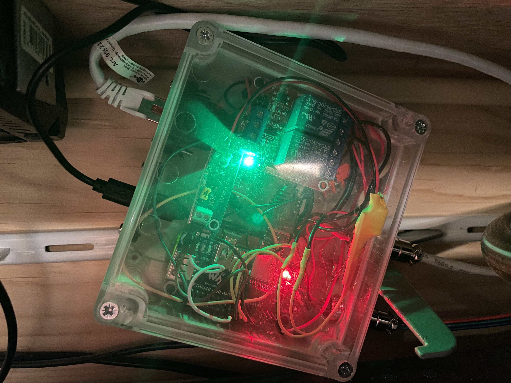
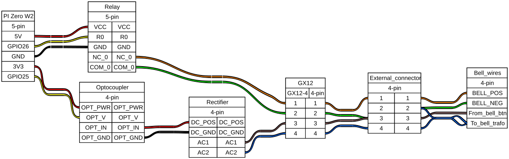
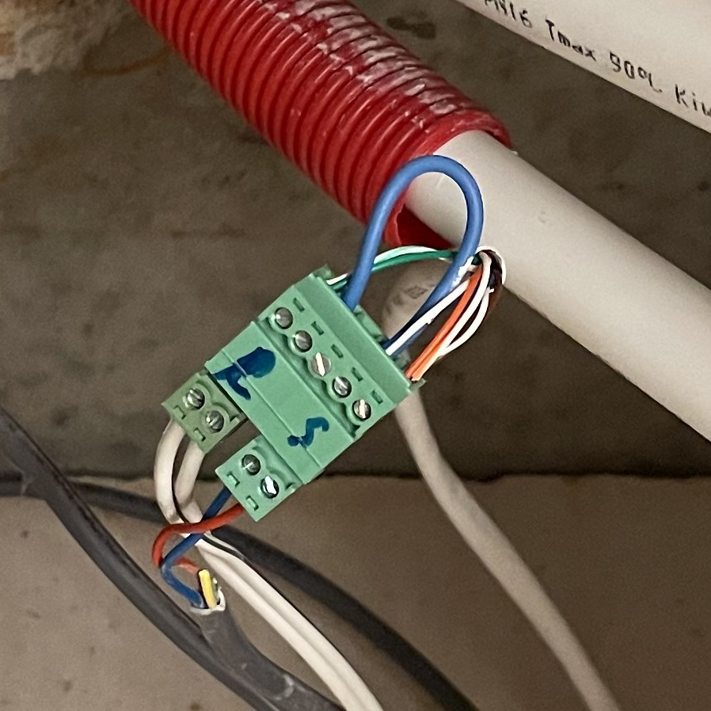
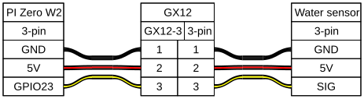
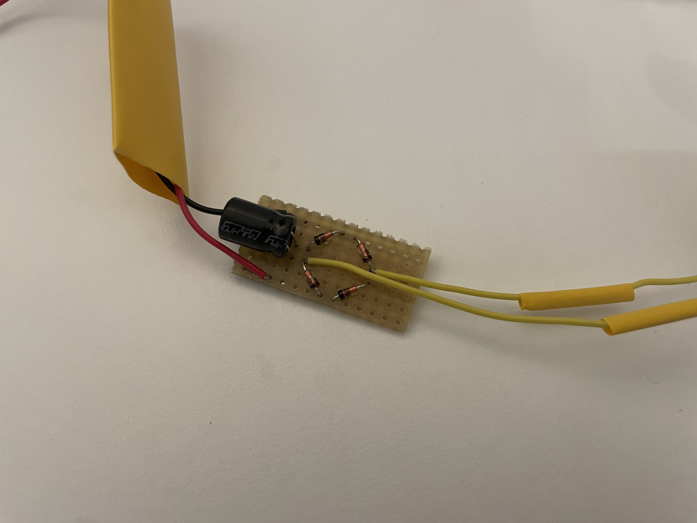
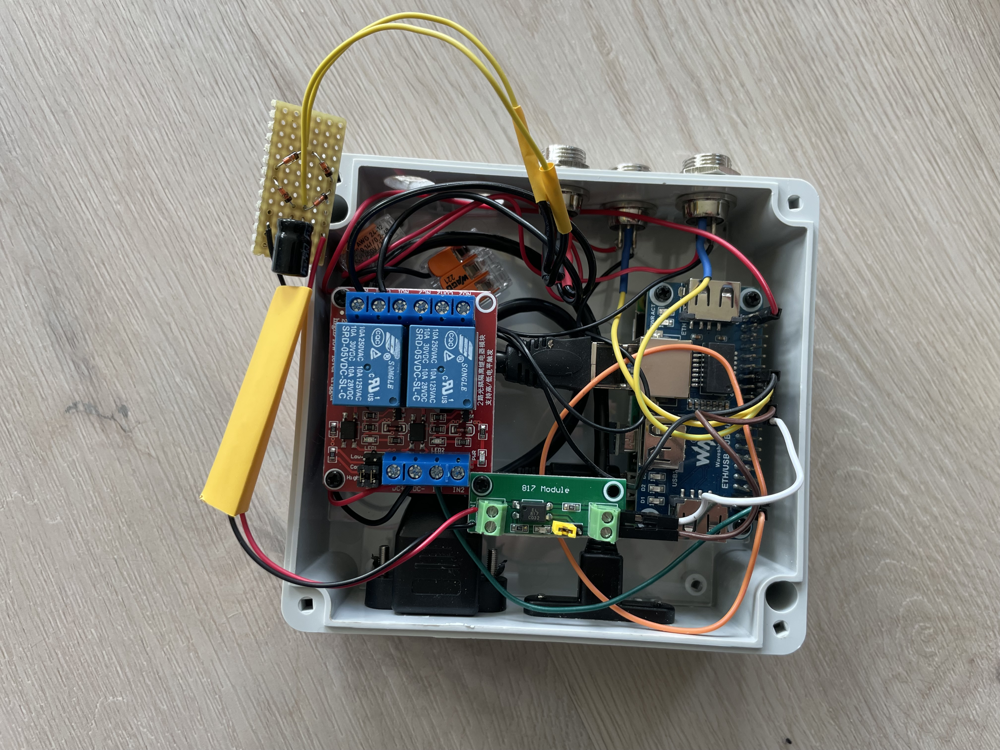
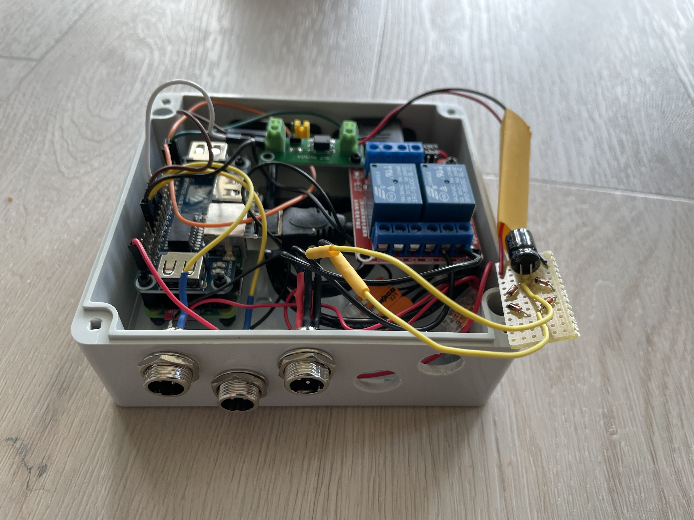
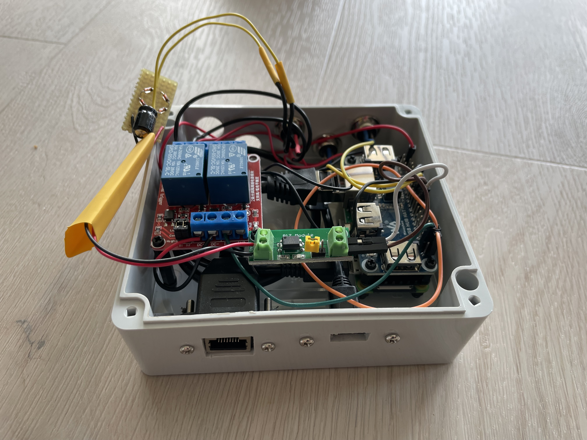

# MKcontroller

HMD-DGB usage example with hardware and configuration for systems in my utility cupboard (Dutch: MeterKast → MK) as privately used.



**Status:** Working personal build; hardware documentation and software setup are provided for adaptation and replication.

## Project Map

- **Hardware and build:** [Hardware Design](#hardware-design), [Pinout & Wiring](#pinout--wiring), and [Assembly Instructions](#assembly-instructions)
- **Wiring sources and diagrams:** [diagrams/](diagrams/)
- **Assembly photos:** [images/](images/)
- **Installation and Home Assistant configuration:** [scripts/](scripts/) and [docs/](docs/)
- **Release history:** [CHANGELOG.md](CHANGELOG.md)

## Overview

The **MKcontroller** is a Raspberry Pi Zero 2W-based controller designed to manage IoT devices and sensors in a home utility cupboard. This is my 4th Pi controller, developed in Q1 2026 as both a practical solution for household automation and a test platform for the [HMD-DGB](https://github.com/jvanoosterhout/HMD-DGB) project.

### History & Motivation

The desire to create this controller existed for a long time, but development began in Q1 2026 following the major update to my personal [HMD-DGB](https://github.com/jvanoosterhout/HMD-DGB) project. The primary objectives were straightforward but practical:

- **Monitor water consumption** to know when to refill the water softener with salt
- **Detect doorbell activation** we frequently missed the bell while being in the garden
- **Control doorbell** disable the physical ring while maintaining sensor capability for notifications

As the [HMD-DGB](https://github.com/jvanoosterhout/HMD-DGB) project matured, the MKcontroller gained an additional critical role: serving as a **test system** for HMD-DGB releases. Other controllers (MV: mechanical ventilatie, BK: Bathroom lights and G: Garage door and garden irrigation, running the former [GPIOpinAPI](https://gitlab.com/jotd/gpiopinapi) or even older developments) manage essential household functions and couldn't risk crashes from experimental code. By mid-Q2 2026, the MKcontroller was operational with alpha releases of HMD-DGB v1.0.0, and this documentation now serves to share the design and allow others to replicate or adapt the concepts.

---

## Requirements

### Core Functionality
- [x] Measure doorbell button presses (for Home Assistant automation → notifications)
- [x] Enable/disable doorbell ring while maintaining sensor capability (with HA automation to auto-toggle after X hours)
- [x] Failsafe: Default state on Pi/controller failure is doorbell rings normally
- [x] Measure hard water consumption

### Optional Features
- [ ] Measure softened water consumption
- [ ] Measure utility cupboard temperature
- [ ] Control ventilation fans (utility cupboard gets warm from city heating system + network equipment + NAS; keeping it cool prevents water softener degradation)
- [ ] Measure city heating consumption

### Connectivity
- Ethernet connection - utility cupboard has too much WiFi interference
- Micro USB connection for power
- GX12 connectors for sensors and actuators. Tried several alternatives (tulip, power, serial RS232), though they were to limited, cheap designed / fagile, or to big.
- Extra cable with 3 way JST SM and GX12-3 connector for the water sensor. The sensor is equiped with a JST SM connector, which I could cut, though I found it more practical/reliable to leave the sensor as is.

---

## Hardware Design

### Bill of Materials

| Component | Details | Notes |
|-----------|---------|-------|
| Raspberry Pi Zero 2W** | Main controller | Single-core equivalent performance |
| Waveshare USB Ethernet HUB HAT for Raspberry Pi Zero | GbE + USB connectivity | Required for non-PoE connection [link](https://www.kiwi-electronics.com/nl/poe-ethernet-usb-hub-hat-voor-rpi-zero-10711)|
| Waveshare Aluminium Heatsink | Thermal management | For Pi Zero 2W [link](https://elektronicavoorjou.nl/product/heatsink-raspberry-pi-zero/)|
| Optocoupler (2-channel | Isolation module | [link](https://www.tinytronics.nl/en/switches/optocouplers/optocoupler-isolation-module-2-channels) |
| 100µF 35V Capacitor | Power conditioning | Added during assembly |
| Uni siliciumdiode 1N4148 100V 100mA | Signal diode for doorbell | [link](https://www.conrad.nl/nl/p/diotec-ultrasnelle-si-diode-1n4148-sod-27-75-v-150-ma-162280.html) |
| GX12-3 Connectors | Water sensors (×2) | [link](https://www.tinytronics.nl/en/cables-and-connectors/connectors/aviation-style/gx12/gx12-3-connector-set)|
| GX12-4 Connector | Doorbell sensor + control | [link](https://www.tinytronics.nl/en/cables-and-connectors/connectors/aviation-style/gx12/gx12-4-connector-set)|
| GX12-2 Connector | Ventilation fan (optional) | [link](https://www.tinytronics.nl/en/cables-and-connectors/connectors/aviation-style/gx12/gx12-2-connector-set)|
| Panel Mount Ethernet extension cable | Ethernet | [link](https://www.kiwi-electronics.com/nl/panel-mount-ethernet-verlengkabel-2542) |
| Delock Micro USB Connector | Power input | [link](https://www.reichelt.com/nl/nl/shop/product/usb_2_0-kabel_micro_b-bus_naar_micro_b-stekker_0_25_m-212024)|
| Removable Screw Terminal - 2 Pin - 3.81 mm                                 |  | [link](https://www.tinytronics.nl/en/cables-and-connectors/connectors/screw-terminals/removable-screw-terminal-2p-3.81mm)|
| YF-B6 Water Flow Sensor - Brass - G3/4"                                    |  | [link](https://www.tinytronics.nl/en/sensors/liquid/yf-b6-water-flow-sensor-brass-g3-4)|
|BOX4U Industrial casing, 125 x 115 x 58 mm EAN 2050000000263| | [link](https://www.reichelt.com/nl/nl/shop/product/industriele_behuizing_125_x_115_x_58_mm_ip65_lichtgrijs-324314) |
| Kradex Enclosure 176x126x57 mm - IP65 - Grey - Transparent - Z74JPH TM ABS |  |This one is used for the 3th version of the MKcontroler, for MK a square one was used|
| 5V Relay Module 2-Channel High-Active or Low-Active                        |  | [link](https://www.tinytronics.nl/en/switches/relays/relay-modules/5v-relay-2-channel-high-active-or-low-active)|
| Wago Clamps | Terminal connections | |
|3 weg JST SM verlengkabel||[link](https://www.kiwi-electronics.com/nl/3-weg-jst-sm-verlengkabel-1-meter-1123)|
| curtom laser cutted mounting plate |  | |
| small piece of pcb prototyping board (e.g. 6 x 12 holes)| |
| Jumper Cables, Heat Shrink, Masking Tape | Wiring & assembly | |


### Tools Required
- 13mm drill
- 3mm drill
- File (to make drill holes square)
- Soldering iron
- Wire stripper (striptang)
- Screwdrivers
- Megger (for safety verification)

---

## Pinout & Wiring

### GPIO Assignments

| Function | GPIO | Notes |
|----------|------|-------|
| Doorbell Sensor | GPIO 25 | PinIn |
| Doorbell Relay 0 | GPIO 26 | PinOut |
| Hard Water Sensor | GPIO 23 | PinCount |
| Soft Water Sensor | GPIO 24 | PinCount (optional) |
| Temperature Sensor | **[TBD]** | Optional onewire/I2C |
| Fan Control | **[TBD]** | Optional PWM or relay |

### Door bell wiring




### Water Sensors wiring

Water 1 (Hard) & Water 2 (Soft - optional at GPIO24):


---

## Assembly Instructions

### Preparation
1. **Prepare casing**
   - Cut internal edges away, these will otherwise trouble installing the connectors.
   - Mark hole positions on the sides for connectors. Mind the hight of the cutom botom plate, connectors must fit clearly above the mounting plate.
   
2. **Fabricate holes**
   - Drill 13mm holes for GX12 connectors
   - Drill 3mm holes at the edges of the box drawen for the USB and Ethernet connector
   - File edges and burrs smooth

3. **Prepare wiring**
   - Pre-cut and strip all internal & external jumpers and wires.
   - Pre-tin connector pins and wires

### Soldering
5. **Heat shrink preparation**
   - Slide (but do not shrink yet) heat shrink tubes over all wires that need isolation.

4. **Solder components** (in this order)
   - Pi GPIO headers to Pi Zero 2W
   - wires to the GX12 connectors (don't forget to slide the covers on the wirebundle first)
   - Diodes (bridge rectifier) + capacitor + wires to the PCB prototyping board


### Assembly
6. **Mount to internal board**
   - Mount Pi + relay board + optocoupler on custom mounting plate
   - Connect all signal and power wires

7. **Testing (before final sealing)**
   - Verify with megger the correct end-to-end wiring (conductivity test)
   - Verify with megger the correct between wire issolation (conductivity test)
   - **Better to catch mistakes now than after shrinking & sealing**

### Final Assembly
8. **Mount in enclosure**
   - Place custom mounting plate in casing
   - Mount all external connectors in casing
   - Route wires

9. **Connect wiring**
   - Connect all external connectors to board
   - Re-test with megger before shrinking



10. **Finalize**
    - Heat shrink all joints
    - Label/document all connectors (optional but recommended)
    - Final functional test with HMD-DGB


---


## Software Setup
Currently running:
- bookworm 32 bit lite
- HMD-DGB v1.0.0b4

### Installation
The installer targets Raspberry Pi OS Bookworm 32-bit and must be run on the Pi. It installs HMD-DGB in a local virtual environment and creates a systemd service.

```sh
git clone https://github.com/jvanoosterhout/MKcontroller.git
cd MKcontroller
sudo ./scripts/install_DGB_service.sh \
   --service-name mk_controller \
   --install-dir "$PWD" \
   --broker 192.0.2.10 \
   --port 1883 \
   --username mqtt_user \
   --password 'change-me' \
   --location meterkast \
   --rate 300
```

Replace the example broker, username, and password with your own values. The installer accepts configuration through command-line options only and stores the settings in `/etc/mk_controller.env` with root-only permissions for systemd to load. Check the service with `sudo systemctl status mk_controller` and view logs with `sudo journalctl -u mk_controller`.

### Configuration
Import or adapt the retained MQTT configuration in [scripts/HA_automation.yaml](scripts/HA_automation.yaml). It defines the doorbell and hard-water entities used by the examples in [docs/home-assistant.md](docs/home-assistant.md).

### Home Assistant Integration
- Doorbell notification and auto-toggle examples: [docs/home-assistant.md](docs/home-assistant.md)

---

## Failsafe Behavior

On power loss or Pi crash, the doorbell operates in its **normal state** (rings) due to the relay design:
- Relay is wired as **Normally Closed (NC)** on the doorbell trigger
- When relay is de-energized → doorbell rings normally
- When relay is energized (via GPIO 26) → doorbell is silenced

This ensures that even if the Pi is completely offline, the doorbell remains functional.

---

## Related Projects

- **[HMD-DGB](https://github.com/jvanoosterhout/HMD-DGB)** - Home automation control platform
- **Other Controllers:**
  - MV (Mechanical Ventilation)
  - BK (Bathroom Lights, in Dutch: BadKamer → BK)
  - G (Garage Door & Garden Irrigation)

---

## License & Disclaimer

This is a personal home automation project shared as-is for educational purposes. Use at your own risk. Electrical work involving relays and/or high voltage should be performed safely and verified before deployment.

---

## TODO

- [x] Add configuration file examples
- [x] Add Home Assistant automation examples
- [ ] Add wiring diagram/schematic
- [ ] Add photos of assembled controller
- [ ] Document temperature sensor integration (optional)
- [ ] Document fan control logic (optional)
- [ ] Add troubleshooting section
- [ ] Add power consumption specs
